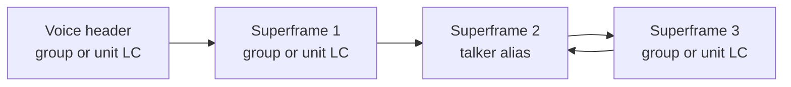
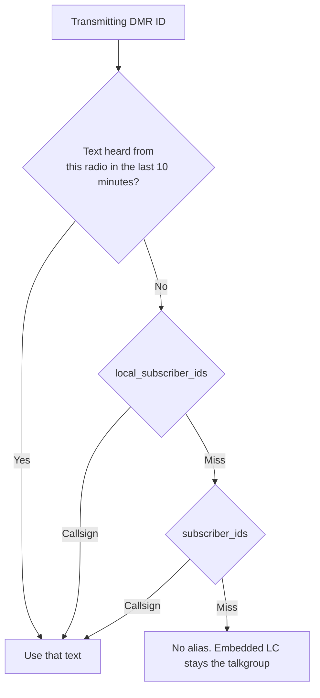
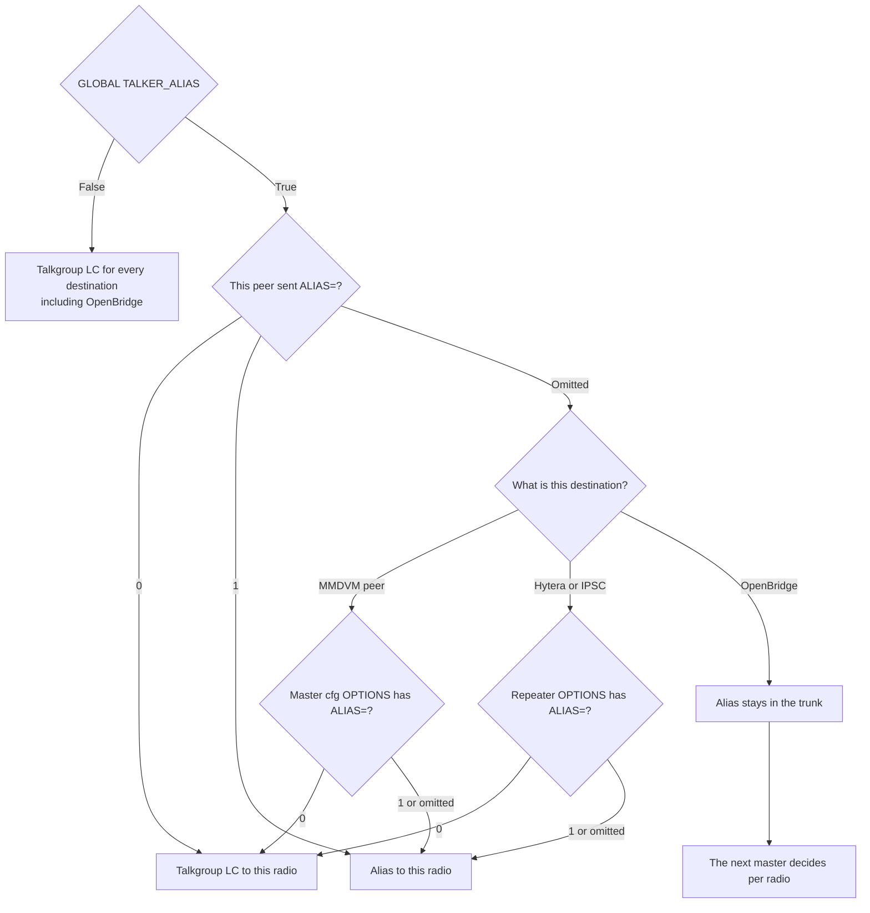
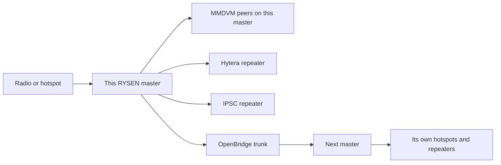

# Talker Alias

Talker alias is the callsign text a receiving radio shows during a voice
call. It rides inside the voice bursts. It does not replace the DMR ID, and
it does not change who hears the audio.

RYSEN follows the ETSI air interface and the same listener-side rule
Brandmeister uses: the transmitting user cannot turn it off for everyone
else, and a repeater or hotspot that cannot take the embedded data can
refuse it for itself.

OPTIONS syntax for the switch is in [options.md](options.md).

## What the radio receives

ETSI TS 102 361-2 (the in-band data service added in 2016) carries the text
in embedded link control on voice bursts B–E of a superframe. A superframe
is 360 ms. The voice header and burst A do not carry the alias.

| FLCO | Role |
|------|------|
| `0x00` | Group voice. Late entry learns the talkgroup from this |
| `0x03` | Unit-to-unit voice |
| `0x04` | Talker alias header: format, length, and the first characters |
| `0x05`–`0x07` | Talker alias blocks 1–3 |
| `0x08` | In-call GPS |

A complete alias is at most four blocks and 31 characters. The receiver is
meant to update the display only after a whole block has arrived, so a
short kerchunk often shows no name. That is the air interface, not a
missing lookup.

ETSI also caps how often non-address data may replace the late-entry LC:
alias or GPS on at most every other superframe. RYSEN keeps the voice
header and the first superframe as group or unit LC, then alternates.



Outbound text is always re-encoded as 7-bit. That is the encoding MMDVM
displays and the one a Hytera shows when its CPS alias format is 7-bit. A
radio set to 16-bit Unicode ignores a 7-bit alias. Voice audio is not
rewritten.

## Where the text comes from

Radio-sent text wins. The subscriber file is the fallback. A numeric string
is not an alias.



Two ways a radio delivers its own text:

- **Embedded alias.** FLCO `0x04`–`0x07` already in the voice bursts. Learned
  from the air or from a bridged stream.
- **DMRA.** A Homebrew datagram. Learned from the logged-in peer on a
  master. In peer mode, an upstream DMRA is accepted. The datagram itself
  is not forwarded and is not sent over OpenBridge. RYSEN turns it into
  embedded LC on the way out.

The heard text is kept for 10 minutes. After that, the subscriber callsign
is used again until the radio sends a new string. Hytera often wraps the
alias as `*CALLSIGN*`. That string is what was received.

The subscriber maps used by the log line `SUB: CALLSIGN (id)` are filled at
startup. The talker-alias lookup is attached when subscriber aliases
reload (`STALE_DAYS`, first run one interval after process start, then
every interval). Until that reload, radio-sent text still works and the
database fallback is empty. `[GLOBAL] TALKER_ALIAS` is re-read on that
reload and about every 26 seconds, so an edit applies without a restart.

## Who is sent an alias

The off switch sits on the listener. A group call is one transmission.
Turning the alias off for the transmitting user would hide the name from
everyone, including radios that can show it. Brandmeister states the same
limit: it cannot be disabled per user, because of the way group calls work.
Brandmeister's filter is the receiving repeater. `ALIAS=0` is that filter.



`[GLOBAL] TALKER_ALIAS` is the process kill. One RYSEN process serves every
master, Hytera, IPSC slot, and the OpenBridge trunk. A key on one master
stanza cannot do that. The code default is on when the key is absent. The
sample configs ship with `False`, so a new install does not send an alias
until someone turns it on.

```ini
[GLOBAL]
TALKER_ALIAS: True
```

The master stanza default is the existing OPTIONS line, not a second
`TALKER_ALIAS` key. Peers that do not send their own `ALIAS=` follow it.
The live OPTIONS string on a shared master is whichever peer wrote last, so
the default is read from the configured line only.

```ini
[MASTER-1]
MODE: MASTER
OPTIONS: ALIAS=0;
```

A hotspot sends the same token in its own options. That string wins.

```ini
TS2=2350;ALIAS=0;
```

Hytera and IPSC are one repeater, so the flag is the repeater's system
OPTIONS. Selfcare writes that string.

```ini
[HYTERA-0]
MODE: HYTERA
OPTIONS: TS1=235;TS2=2350;ALIAS=0;

[IPSC-1]
MODE: IPSC
OPTIONS: TS2=2350;ALIAS=1;
```

`0`, `1`, `true`, `false`, `yes`, and `no` are accepted. An unrecognised
value is ignored. The choice is read from the OPTIONS string at send time,
so a selfcare or hotspot update applies on the next burst. The options log
records `ALIAS=0`, `ALIAS=1`, or `default` when it changes.

## How it moves through the network



On a bridged group call the embedded link control is rewritten for the
destination. Peers that want the alias share one packet, and the alias
cadence advances once per call. An `ALIAS=0` peer on that master is put
back to talkgroup LC before the packet is sent. Hytera does not build its
own blocks: the bridged DMR burst already contains talkgroup LC or the
alias, and the repeater pair-swaps it onto RF. IPSC encodes the same
choice into the repeater's outbound voice.

OpenBridge keeps the alias while the global flag is on. The master at the
far end learns it from the bursts and applies its own `ALIAS=` rules. A
master still on 1.6.2 rewrites those bursts back to talkgroup LC, which is
the same result as a c-Bridge hop: the protocol in between has nowhere to
keep it.

A same-master repeat does not send our inserted alias to an `ALIAS=0`
peer. It does forward the burst that arrived. If the transmitting radio
had already embedded its own alias, that text still reaches the neighbour.
Brandmeister removes that too, including toward a repeater that would
break. That strip is not done on the local repeat path.

Private calls are not given a database alias. An alias is shown only when
the transmitting radio already embedded one. Parrot rewrites the source to
subscriber `9990`. A numeric id is not an alias, so playback does not show
the caller's callsign.

A bridged call replaces bursts B–E with talkgroup LC or the alias. In-call
GPS that arrived in those bursts does not survive the bridge. Brandmeister
forwards GPS as well as the alias. Local repeat leaves a voice superframe
as it arrived, so GPS in that superframe is unchanged.

## Comparison

| | Brandmeister | MMDVMHost | RYSEN |
|---|---|---|---|
| Radio text wins | Yes | Passes through what the air carried | Yes. Embedded text, then DMRA |
| Database fallback | Callsign plus SelfCare APRS text, group calls | None. The hotspot does not invent one | Callsign from the subscriber file |
| On-air format | Passes the radio's encoding, or the server's | Whatever the network sent | Always 7-bit ETSI blocks |
| Who can turn it off | Receiving repeater class. Not the transmitting user | `EmbeddedLCOnly=1` on that modem | `ALIAS=0` on that hotspot, Hytera, or IPSC repeater |
| Whole server off | Not a published user switch | Per modem only | `[GLOBAL] TALKER_ALIAS: False` |
| Trunk | Forwarded when the protocol can hold embedded LC | DMRGateway must preserve it across a rewrite | OpenBridge keeps it. The next master decides |
| Hop that drops it | c-Bridge, KAIROS, older Motorola repeaters | A network that never sent it | A 1.6.2 master rewrites bursts to talkgroup LC |
| In-call GPS | Passed with the other embedded data | Passed unless `EmbeddedLCOnly=1` | Not kept on a bridged call |

Brandmeister's published behaviour is pass-through plus server generation.
The radio's text has priority. If the radio sent nothing, the master builds
callsign plus the SelfCare APRS text. Their FAQ says a per-user off switch
is not possible. Older Motorola repeaters (R2.10 and earlier) can drop
audio when they see the embedded data, so those repeaters are not sent the
alias. Hytera from repeater firmware 7.06 and radio firmware v8, MMDVM,
Pi-Star, and openSPOT from firmware 0084 do get it. Motorola from
M2020.02 is listed as able to receive it. Their 2025 notes say the master
accepts only a complete valid alias and transmits it only once it is
complete.

MMDVMHost extracts FLCO `0x04`–`0x07` and can hand the blocks to the
network. `EmbeddedLCOnly=1` keeps the call addressing and drops alias and
GPS. openSPOT's "send no in-band data to the modem" is the same last-hop
gate. DMR+ was widely reported as not carrying the alias. DMRGateway is
only a rewriter: if a rule rebuilds the burst and drops the embedded data,
the alias disappears even when Brandmeister sent one.

`ALIAS=0` is the same decision as Brandmeister's repeater filter and
MMDVMHost's `EmbeddedLCOnly=1`. A per-peer flag fits a shared master
better than a fixed list of repeater models, because firmware inside one
brand is not uniform.

## Implementation

`talker_alias.py` owns the air format. It decodes embedded LC and DMRA,
chooses the text, and builds 7-bit FLCO blocks. The local embedded-LC
encoder is used for the alias because the copy in `dmr_utils3` repeats one
BPTC bit and drops the next. That dropped bit sits in the length, and
radios then truncate the callsign. Voice LC still uses the library encoder.

`AliasSchedule` is one transmitting station on one leg. The first
superframe is voice LC. Later superframes alternate. A second voice header
for the same source keeps the cadence. A different source starts again.
Voice that arrives before the header is left as received. A header that
does not yield link control does not get an inserted alias.

Each master has its own repeat schedule. Stream IDs are four bytes and are
reused, so two Homebrew masters in one process must not share one.

The gates are the last hop:

| Path | Where | `ALIAS=0` |
|------|--------|-----------|
| Bridged group call to a Homebrew master | `bridge_master.py` builds one packet, `hblink.py` `send_peers` restores talkgroup LC for the opted-out peer | Talkgroup LC |
| Same-master repeat | `hblink.py` calls `embed_repeat` once, then sends the original burst to an opted-out peer | Our alias is not inserted. A radio-sent alias in the arrived burst is still forwarded |
| Hytera | `bridge_master.py` chooses talkgroup LC before `hytera_send_system` | Talkgroup LC |
| IPSC | `ipsc_master.py` sets `_send_alias` from the repeater OPTIONS. `ipsc_voice.py` embeds voice LC instead of the alias | Talkgroup LC |
| OpenBridge | Both routers keep the alias block | Unchanged while the global flag is on |

Learning stays on when a destination has opted out. A radio that sends an
alias is still remembered, and other listeners can be shown it.

## References

- ETSI TS 102 361-2, clause 5.4.3 (in-band talker alias) and clause 7.1.1
  (FLCO `0x04`–`0x07`). The 1:1 limit on non-address embedded data is in
  the in-band data overview.
- [Brandmeister: Talker Alias](https://wiki.brandmeister.network/index.php/Talker_Alias)
  — pass-through, server generation, and which repeater firmware is listed.
- [Brandmeister: Simple External Application](https://wiki.brandmeister.network/index.php/Simple_External_Application)
  — embedded LC on the application API, and the server setting the alias
  from `sourceCall`.
- MMDVMHost `[DMR] EmbeddedLCOnly` — the modem keeps call LC and drops
  other embedded data when this is `1`.
- DMR Brescia, *Talker Alias* — operator description of Brandmeister
  pass-through versus server generation, including why a radio-sent alias
  is the one that still reaches a repeater the network would otherwise
  have skipped.
